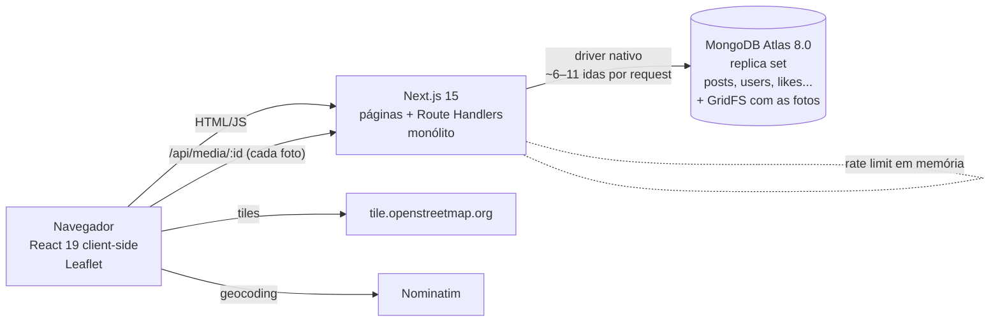
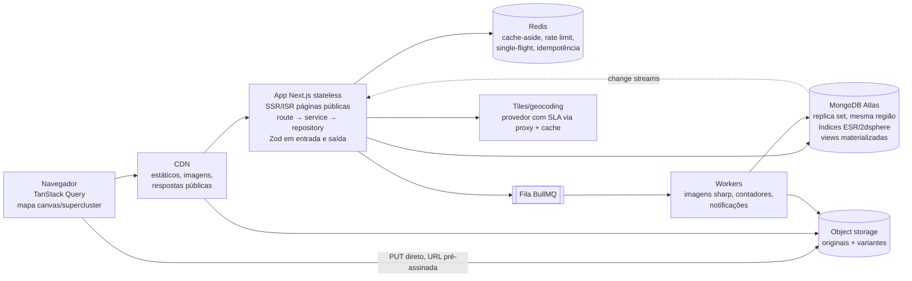

# Arquitetura — atual vs. proposta

## Atual (2026-11-22)

Pontos fracos: fotos passam pelo Node e moram no banco; nenhum cache; estado em memória por instância; páginas só no cliente; serviços externos (tiles, geocoding) chamados direto do navegador.

## Proposta (alvo das Fases 1–6)

Princípios: monólito modular (sem microserviços prematuros); app sem estado para escalar horizontalmente; nada de bytes de imagem no Node; MongoDB continua sendo o banco principal.
